  

  
  
  
  
  
  

<h1 align="center">🧊 Awesome Open Table Formats 🚀</h1>

  <strong>A curated directory of SaaS Lakehouse Platforms, Open-Source Table Formats, REST Catalogs, and Translation Engines.</strong> 
  <em>Supercharge cloud object storage with ACID transactions, schema evolution, time travel, hidden partitioning, and true multi-engine interoperability across Spark, Trino, Flink, and Snowflake.</em>

---

## 📑 Table of Contents
- [🔍 Introduction](#-introduction)
- [📊 Sector Overview & Market Dynamics](#-sector-overview--market-dynamics)
- [🏢 SaaS & Managed Lakehouse Platforms](#-saas--managed-lakehouse-platforms)
- [💻 Open-Source GitHub Projects](#-open-source-github-projects)
- [⚖️ Architectural Comparison & Trade-Offs](#-architectural-comparison--trade-offs)
- [🤝 How to Contribute](#-how-to-contribute)
- [💖 Support & Community](#-support--community)
- [📈 Star History](#-star-history)
- [📜 Disclaimer & License](#-disclaimer--license)

---

## 🔍 Introduction

Open Table Formats represent the architectural metadata layer that elevates raw object storage (such as Amazon S3, Google Cloud Storage, Azure Data Lake Storage, or MinIO) into a full-fledged **Data Lakehouse**. By establishing atomic transaction logs and structured snapshot trees on top of immutable columnar files (Parquet, ORC, Avro), table formats deliver database-grade capabilities directly to analytical lakes:

- 🛡️ **Full ACID Transactions**: Serialized isolation guarantees ensuring read consistency while continuous stream writes or batch jobs execute simultaneously.
- ⏳ **Time Travel & Rollback**: Point-in-time snapshot isolation, auditable historical versioning, and zero-copy rollback capabilities.
- 🧬 **Schema Evolution**: Safe column additions, renames, drops, and promotions without rewriting underlying petabyte-scale data files.
- 📁 **Hidden Partitioning & File Pruning**: Automatic partition evolution and min/max column statistics eliminating manual directory layout management.
- 🌐 **Multi-Engine Freedom**: Concurrent query execution across Apache Spark, Trino, Presto, Apache Flink, Snowflake, and DuckDB without data duplication or vendor lock-in.

---

## 📊 Sector Overview & Market Dynamics

The global data lakehouse and open table storage layer market is valued at approximately **$18.5 Billion in 2024** and is projected to surpass **$65.0 Billion by 2030**, expanding at a robust **CAGR of ~22.8%** driven by enterprise migration away from closed data warehouses toward cost-effective cloud object storage.

In terms of structure, the sector is **moderately concentrated into an oligopoly** at the managed infrastructure and compute layer — dominated by hyperscalers (Microsoft Azure, Google Cloud, AWS) alongside independent data platform titans (Databricks and Snowflake). However, at the table format and metadata layer, market dynamics actively resist a "winner-take-all" outcome:
1. **The Convergence on Apache Iceberg**: Driven by open REST catalog specifications (`Apache Polaris`, `Lakekeeper`, `Project Nessie`), Apache Iceberg has established itself as the de facto open standard for engine neutrality, adopted natively across Snowflake, AWS S3 Tables, Google BigQuery, and Databricks.
2. **The Dual-Format Standard**: Databricks continues to anchor massive production footprints around Delta Lake, introducing Universal Format (UniForm) to generate Iceberg and Hudi metadata automatically.
3. **Omni-Directional Bridges**: Open-source cross-converters like **Apache XTable** prevent ecosystem bifurcation, allowing enterprises to read and write across Delta Lake, Iceberg, and Hudi without physical data copies.

---

## 🏢 SaaS & Managed Lakehouse Platforms

The following hosted platforms provide fully managed lakehouse architectures, automated table compaction, enterprise governance, and serverless compute over open table formats.

> [!NOTE]
> Platforms are sorted in descending order by **Company Size (Market Capitalization / Valuation)**.

| 🏢 Platform / Product | 🌐 Company & Size | 💳 Specific Starting Pricing | 🎁 Specific Free Tier / Trial Limits | 🧊 Supported Formats & Interoperability |
| :--- | :--- | :--- | :--- | :--- |
| [**Microsoft Fabric / OneLake**](https://www.microsoft.com/en-us/microsoft-fabric) | **Microsoft** • Valuation: **~$3.12 Trillion** • Revenue: **~$245.1B** | **$0.36/hour** for baseline F2 Capacity SKU ($262.80/month pay-as-you-go); OneLake storage starts at **$0.023/GB/month** ($23.55/TB/month). | **60-Day Free Trial** with up to **64 Capacity Units (F64 SKU)** and **1 TB of OneLake storage** (no credit card or Azure subscription required); or Azure free tier with **$200 credit for 30 days**. | Native Delta Lake foundation; automatic bi-directional Iceberg read/write interop via Delta UniForm; zero-copy shortcuts to AWS S3 & GCP buckets. |
| [**Google BigQuery & BigLake**](https://cloud.google.com/bigquery) | **Alphabet (Google)** • Valuation: **~$2.18 Trillion** • Revenue: **~$307.4B** | **$6.25 per TB** scanned for On-Demand SQL queries; compute editions start at **$0.04 per slot-hour** (Standard Edition); active storage starts at **$0.020/GB/month**. | **Free Forever Tier**: **1 TB of SQL queries/month** and **10 GB of storage/month** permanently free via BigQuery Sandbox; plus **$300 credit for 90 days** for new GCP signups. | Native Apache Iceberg table support via BigLake metastore; direct queries on Iceberg tables in Google Cloud Storage, Amazon S3, and Azure Data Lake Storage Gen2. |
| [**AWS Lake Formation & S3 Tables**](https://aws.amazon.com/s3/features/tables/) | **Amazon Web Services** • Valuation: **~$1.95 Trillion** • AWS Rev: **~$105B+** | Lake Formation has **$0 software fee**; Amazon S3 Tables starts at **$0.021/GB/month** table storage, **$0.005 per 1,000 PUT/POST**, and **$0.0004 per 1,000 GET**; Athena queries cost **$5.00/TB**. | **AWS Free Tier (12 Months)**: **5 GB standard S3 storage**, 20,000 GET requests, 2,000 PUT requests/month; **1 Million free Glue requests/month**; first 1 TB scanned on Athena free for trial. | First-class native Apache Iceberg support via S3 Tables; centralized column/row-level access control with Lake Formation and AWS Glue Data Catalog. |
| [**Snowflake**](https://www.snowflake.com/) | **Snowflake Inc.** • Valuation: **~$45.2 Billion** • Revenue: **~$3.63B** | **$2.00 per Snowflake Credit** (Standard Edition, 1 credit/hour for X-Small warehouse); native storage at **$23/TB/month**; external Iceberg tables incur **$0 storage markup**. | **30-Day Free Trial** with **$400 in usage credits** allowing full deployment of Virtual Warehouses, Snowpark routines, and Iceberg table queries without commitment. | Full DDL/DML support for Apache Iceberg tables with managed and unmanaged modes; native open-source Apache Polaris REST catalog integration. |
| [**Databricks Lakehouse**](https://www.databricks.com/) | **Databricks, Inc.** • Valuation: **~$43.0 Billion** • Revenue: **~$2.60B ARR** | Serverless SQL starts at **$0.22/DBU**; Data Engineering Jobs Compute starts at **$0.15/DBU**; All-Purpose Interactive Compute starts at **$0.40/DBU** (1 DBU baseline). | **Databricks Community Edition is Free Forever** with 1 micro-cluster (1 driver, 15.3 GB RAM, 2 cores, no workers); plus **14-day free trial** with full enterprise features on AWS/Azure/GCP. | Creator and primary steward of Delta Lake; multi-statement transactions; Unity Catalog OSS governance; Delta UniForm auto-generates Iceberg and Hudi metadata. |
| [**Starburst Galaxy**](https://www.starburst.io/platform/starburst-galaxy/) | **Starburst Data** • Valuation: **~$3.35 Billion** • Revenue: **~$100M+ ARR** | Standard cluster compute starts at **$0.35 per Starburst Credit** (~$0.35/hour for an extra-small worker node); Enterprise cluster at **$0.55 per credit**. | **$500 Free Usage Credits** automatically credited upon account signup, valid indefinitely across AWS, GCP, and Azure with no credit card required upfront. | Distributed Trino engine optimized for low-latency queries across Apache Iceberg, Delta Lake, and Apache Hudi; cross-cloud federation and data lake mesh governance. |
| [**Dremio Cloud**](https://www.dremio.com/) | **Dremio Corporation** • Valuation: **~$2.00 Billion** • Revenue: **~$80M-$100M ARR** | Enterprise Cloud tier starts at **$0.39 per Dremio Edition Unit (DCU)** per hour; Standard Cloud edition software license fee is **$0.00/hour** (pay only underlying cloud VM costs). | **Free Forever Standard Edition** with **unlimited users and unlimited queries** (perpetual zero software license fee); plus **14-Day Free Enterprise Trial** with technical support. | Native Apache Arrow-powered SQL query engine; built-in Nessie-based catalog providing Git-like branching, tagging, and multi-table transactions for Apache Iceberg. |
| [**Tabular** *(Databricks)*](https://tabular.io/) | **Tabular / Databricks** • Valuation: **~$1.00+ Billion** • Acquired: **2024** | Tabular standalone catalog managed operations started at **$0.10 per 1M operations** (now integrated into Databricks Lakehouse unified pricing). | **30-Day Free Trial** offering up to **1 TB of managed Iceberg metadata** storage and 100,000 free REST catalog API requests. | Built by Netflix creators of Apache Iceberg; universal REST catalog and automated compaction engine ensuring continuous data clustering and optimal file sizes. |

---

## 💻 Open-Source GitHub Projects

Explore the leading open-source table format specifications, standalone execution kernels, metadata catalogs, and translation bridges.

> [!TIP]
> Projects are strictly sorted in descending order by **GitHub Star Count**. Star count badges reflect live repository stargazers.

### 1. [Apache Iceberg](https://github.com/apache/iceberg) 
- 📌 **Overview**: The open industry standard for multi-engine table interoperability, governed neutrally under the Apache Software Foundation.
- ⚡ **Core Strengths**: Delivers the lowest-latency analytical queries and most efficient storage footprint in independent benchmarks. Broadest compute engine ecosystem: Spark, Trino, PrestoDB, Flink, Snowflake, and DuckDB all read the exact same table without format translation.
- 🛠️ **REST Catalog Specification**: Standardized HTTP REST protocol implemented by Lakekeeper, Polaris, and AWS S3 Tables for multi-cloud, credential-vended metadata access.
- 🎯 **Best For**: Organizations prioritizing multi-engine flexibility, engine-neutral lakehouses, and avoiding storage metadata lock-in.

### 2. [Delta Lake](https://github.com/delta-io/delta) 
- 📌 **Overview**: The foundational storage framework originating from Databricks, boasting the largest installed production base in the Apache Spark ecosystem.
- ⚡ **Core Strengths**: Unrivaled bulk data ingestion throughput, robust ACID transaction guarantees, and multi-statement transaction capabilities. Universal Format (UniForm) generates Iceberg and Hudi metadata alongside Delta transaction logs.
- 🛠️ **Kernel & Extensions**: Native Delta Kernel provides lightweight JVM-independent APIs, alongside `delta-rs` for non-JVM runtimes.
- 🎯 **Best For**: Spark-centric engineering pipelines, Databricks deployments, and high-throughput batch ETL workloads.

### 3. [Lance](https://github.com/lance-format/lance) 
- 📌 **Overview**: Modern columnar data format engineered from scratch in Rust for multimodal AI, machine learning datasets, and vector search.
- ⚡ **Core Strengths**: 100x faster random access than Parquet; native vector indexing (IVF-PQ, IVF-SQ); zero-copy integration with DuckDB, Polars, PyTorch, and PyArrow.
- 🛠️ **Features**: Built-in versioning, point-in-time time travel, and native embedding search without needing a separate vector database.
- 🎯 **Best For**: AI/ML pipelines, multimodal training datasets (images, audio, embeddings), and real-time retrieval-augmented generation (RAG).

### 4. [Apache Hudi](https://github.com/apache/hudi) 
- 📌 **Overview**: High-performance streaming lakehouse platform built specifically for real-time upserts, deletes, and incremental processing.
- ⚡ **Core Strengths**: Near-O(1) record mutations via its patented Record Index; cutting data freshness intervals down from hours to minutes on petabyte-scale lakes. Native `VECTOR`, `VARIANT`, and `BLOB` data types for multimodal AI workloads.
- 🛠️ **Storage Types**: Copy-on-Write (optimized for analytical query read performance) and Merge-on-Read (optimized for high-frequency write throughput).
- 🎯 **Best For**: Change Data Capture (CDC) ingestion, Kafka streaming writes, and real-time upsert-heavy data lake operations.

### 5. [Unity Catalog OSS](https://github.com/unitycatalog/unitycatalog) 
- 📌 **Overview**: Open-source, multi-modal governance catalog for tables, files, functions, and AI models donated by Databricks to the open-source community.
- ⚡ **Core Strengths**: Centralizes fine-grained access control across both Delta Lake and Apache Iceberg tables. Implements the Iceberg REST Catalog API for multi-engine compatibility.
- 🛠️ **AI Governance**: Native tracking of GenAI tools, prompts, MLflow models, and tabular features within the same unified security boundary.
- 🎯 **Best For**: Unified data & AI governance across heterogeneous query engines (Spark, Trino, DuckDB, Daft).

### 6. [Apache Paimon](https://github.com/apache/paimon) 
- 📌 **Overview**: Streaming data lake format rooted in Apache Flink, designed for sub-minute data freshness and real-time streaming reads/writes.
- ⚡ **Core Strengths**: High-throughput streaming ingestion with Log-Structured Merge-tree (LSM) data layouts; flexible merge engines (deduplication, partial-update, aggregation).
- 🛠️ **Vector Indexing**: Integrated `paimon-vector-index` module provides IVF-PQ vector indexing with Rust, Java, and Python bindings.
- 🎯 **Best For**: Flink-centric real-time streaming architectures, high-cardinality streaming aggregations, and sub-minute analytical dashboards.

### 7. [delta-rs](https://github.com/delta-io/delta-rs) 
- 📌 **Overview**: Pure Rust implementation of the Delta Lake protocol with high-performance Python bindings (`deltalake`).
- ⚡ **Core Strengths**: Allows Python and Rust developers to read, write, and execute ACID transactions on Delta tables without Java, Scala, or Apache Spark installed.
- 🛠️ **Ecosystem**: First-class integration with Polars, DuckDB, DataFusion, and AWS Lambda serverless functions.
- 🎯 **Best For**: Microservices, lightweight Python pipelines, edge computing, and serverless data lake automation.

### 8. [Apache Gravitino](https://github.com/apache/gravitino) 
- 📌 **Overview**: Open, high-performance, geo-distributed, and federated metadata lake catalog.
- ⚡ **Core Strengths**: Provides a unified metadata architecture across relational tables (Iceberg, Delta Lake, Apache Hive), unstructured files, and AI models across multi-cloud regions.
- 🛠️ **Access Control**: Fine-grained data access permissions, data auditing, and multi-region metadata replication.
- 🎯 **Best For**: Global enterprise data architectures managing multi-format, multi-cloud data lakes under a single federated API.

### 9. [Apache Polaris](https://github.com/apache/polaris) 
- 📌 **Overview**: Open-source catalog for Apache Iceberg implementing the open REST Catalog specification, donated by Snowflake to the Apache Software Foundation.
- ⚡ **Core Strengths**: Delivers vendor-neutral multi-engine interoperability, role-based access control (RBAC), and automated temporary credential vending for cloud object storage.
- 🛠️ **Engine Independence**: Connects Snowflake, Apache Spark, Trino, Apache Flink, and StarRocks to a shared Iceberg metadata layer without lock-in.
- 🎯 **Best For**: Teams standardizing on Iceberg REST catalogs who want self-hosted, cloud-agnostic security governance.

### 10. [Project Nessie](https://github.com/projectnessie/nessie) 
- 📌 **Overview**: Transactional catalog for data lakes introducing Git-like version control semantics to Apache Iceberg and Delta Lake.
- ⚡ **Core Strengths**: Enables branching (`main`, `dev`, `feature/experiment`), tagging, and atomic merging across multi-table transactions. Test pipeline transformations on isolated branches of production data without duplicating files.
- 🛠️ **Zero-Copy CI/CD**: Run end-to-end data validation and schema migrations on dedicated branches, merging to `main` only upon automated testing success.
- 🎯 **Best For**: Data teams requiring Git-for-Data branching, zero-copy staging environments, and multi-table atomic consistency.

### 11. [Lakekeeper](https://github.com/lakekeeper/lakekeeper) 
- 📌 **Overview**: Blazingly fast Apache Iceberg REST Catalog implementation written in Rust (`apache/iceberg-rust`).
- ⚡ **Core Strengths**: Minimal CPU and memory footprint, lightning-fast response times, Docker quickstart, and built-in management UI.
- 🛠️ **Security**: Native support for OpenID Connect (OIDC), OAuth2, role-based access control (RBAC), and S3/GCS/Azure credential vending.
- 🎯 **Best For**: Lightweight, self-hosted, high-concurrency Iceberg REST catalog deployments in Kubernetes or containerized environments.

### 12. [Apache XTable](https://github.com/apache/incubator-xtable) 
- 📌 **Overview**: Omni-directional cross-table metadata converter incubated by the Apache Software Foundation.
- ⚡ **Core Strengths**: Seamlessly translates table metadata between Apache Iceberg, Delta Lake, and Apache Hudi without copying or re-writing underlying Parquet data files.
- 🛠️ **Runtime Bundle**: Runs as a lightweight Spark runtime utility or standalone CLI for continuous, incremental metadata synchronization.
- 🎯 **Best For**: Organizations bridging disparate departments (e.g., Spark-heavy Delta pipelines feeding Trino-heavy Iceberg consumers) without paying double storage bills.

### 13. [Apache Amoro](https://github.com/apache/amoro) 
- 📌 **Overview**: Autonomous lakehouse management system built on top of open data lake formats (Apache Iceberg and Apache Paimon), formerly known as Arctic.
- ⚡ **Core Strengths**: Autonomous self-optimizing compaction, automated small file merging, data sorting, expired snapshot expiration, and orphan file cleanup.
- 🛠️ **Data Freshness**: Continuous real-time metrics tracking table write latencies and automated maintenance scheduling.
- 🎯 **Best For**: Platform engineering teams wanting to eliminate manual compaction cron jobs and maintain peak query performance on active lakes.

### 14. [PyIceberg](https://github.com/apache/iceberg-python) 
- 📌 **Overview**: The official pure-Python implementation of the Apache Iceberg table format specification.
- ⚡ **Core Strengths**: Reads and writes Iceberg tables directly into PyArrow tables, Pandas DataFrames, or DuckDB without requiring a JVM or Spark installation.
- 🛠️ **Catalog Support**: Full integration with REST Catalogs, AWS Glue, Hive Metastore, and Project Nessie.
- 🎯 **Best For**: Python data scientists, ML feature stores, Ray pipelines, and lightweight serverless analytics.

---

## ⚖️ Architectural Comparison & Trade-Offs

Choosing an open table format depends heavily on your ingestion velocity, query engine topology, and operational constraints:

| Architectural Dimension | 🧊 Apache Iceberg | ⚡ Delta Lake | 🔥 Apache Hudi | 🌊 Apache Paimon | 🚀 Lance Format |
| :--- | :--- | :--- | :--- | :--- | :--- |
| **Primary Design Philosophy** | Multi-engine analytical abstraction | Spark-native lakehouse foundation | High-frequency CDC & incremental writes | Flink-native streaming lakehouse | Multimodal AI, random access & vectors |
| **ACID Isolation Level** | Serializable (Optimistic Concurrency) | Serializable / Snapshot Isolation | Snapshot Isolation / Optimistic Concurrency | Snapshot Isolation | Snapshot Isolation |
| **Metadata Architecture** | Hierarchical JSON & Avro snapshot manifests | Transaction log of JSON & Parquet checkpoints | Timeline log with instant commit metadata | LSM-tree manifests & changelog files | Self-contained columnar manifest |
| **Partitioning Strategy** | Hidden Partitioning & Partition Evolution | Directory-based Partitioning + Generated Cols | Key-based & Directory Partitioning | Bucket-based primary key partitioning | Vector index & logical partitions |
| **Catalog Requirement** | Required (REST, Glue, Nessie, Hive, JDBC) | Optional (Path-based or Unity Catalog) | Optional (Path-based or Hive/Glue) | Optional (Filesystem or Hive/Spark) | Embedded in directory structure |
| **Streaming CDC Suitability** | Moderate (Append & Merge-on-Read) | High (Append, Upsert, Change Data Feed) | **Exceptional** (Record Index key lookups) | **Exceptional** (LSM merge engines) | Emerging (Batch/Vector focus) |
| **AI / Multimodal Support** | External via vector databases | External via vector databases | Native `VECTOR` & `VARIANT` types | Integrated `paimon-vector-index` | **Native** (Fast vector IVF-PQ, Tensors) |

---

## 🤝 How to Contribute

We welcome contributions from across the data engineering and open-source community!

1. 🍴 **Fork the repository** to your personal GitHub account.
2. 🌿 **Create a dedicated feature branch** (`git checkout -b feature/add-new-table-format-tool`).
3. 📝 **Edit `README.md`**: Follow existing formatting rules (specific pricing without generic placeholders, exact free trial limits, and `style=social&color=white` stargazer badges for open-source repos).
4. 🧪 **Validate links & citations**: Verify that all documentation and official project URLs point to authentic sources.
5. 🚀 **Submit a Pull Request** with a brief summary of the project and why it belongs in the ecosystem.

---

## 💖 Support & Community

Thank you for exploring **Awesome Open Table Formats**! If you find this curated directory valuable for architecting your modern data lakehouse or evaluating open storage specifications, please consider supporting the project:

- ⭐ **Star this repository** to improve visibility for data engineers and lakehouse architects worldwide.
- 🍴 **Fork and contribute** by submitting PRs for new open-source catalogs, benchmarks, or engine integrations.
- 📢 **Share with fellow data architects** on LinkedIn, Twitter, Discord, and Slack communities.
- ☕ **Sponsor ongoing research**: Support maintenance and deep-dive technical benchmarks via the [GitHub Sponsor Dashboard](https://github.com/sponsors/ishandutta2007).

  

---

## 📈 Star History

---

## 📜 Disclaimer & License

- **Disclaimer**: This repository is an independent, community-driven curated directory. All product names, trademarks, and registered logos belong to their respective corporations and foundations (Apache Software Foundation, Linux Foundation, Databricks, Snowflake, Google, Microsoft, Amazon). Software pricing, free tier parameters, and benchmarks reflect publicly available information and are subject to change.
- **License**: Released under the [MIT License](LICENSE) — free for use, sharing, and commercial reference.
